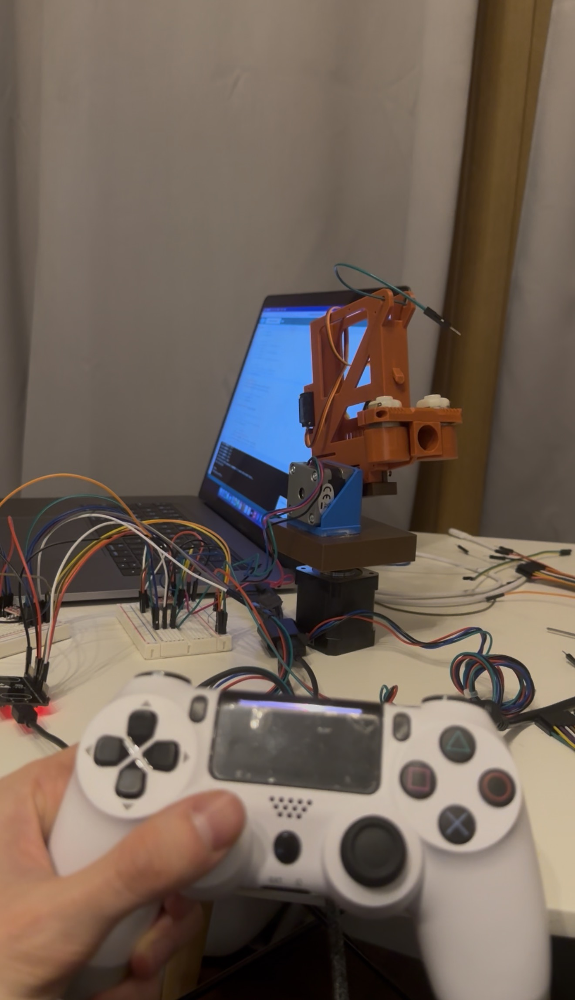
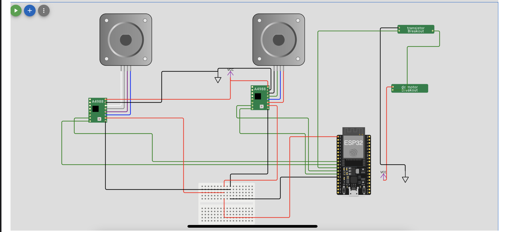

# Nerf Toy Turret

A 2-axis desktop turret that fires Nerf darts, driven by an ESP32 and controlled wirelessly with a PS4 controller.

## Demo

## Overview

- **Pan and tilt**: two NEMA 17 stepper motors, each driven by an A4988 driver.
- **Launcher**: a DC motor flywheel launcher, switched by a transistor.
- **Control**: a PS4 controller connected to the ESP32 over Bluetooth with [Bluepad32](https://github.com/ricardoquesada/bluepad32).

### What's mine and what's reused

| Part | Origin |
|---|---|
| Launching mechanism | Based on an existing design: _TODO: add link and credit_ |
| Turret frame, base and motor mounts | Designed in 3D and printed by me |
| Wiring | Designed and built by me |
| Firmware | Written by me |

## Hardware

- ESP32 dev board
- 2× NEMA 17 stepper motors
- 2× A4988 stepper drivers
- DC motor(s) for the launcher, plus a transistor module to switch them
- Breadboard and jumper wires
- External power supply for the motors
- 3D-printed parts
- PS4 DualShock 4 controller

## Wiring

The ESP32 sends STEP/DIR/ENABLE signals to each A4988. The drivers get their motor power from the external supply. The launcher's DC motor is switched by a transistor whose base is driven by an ESP32 GPIO. All grounds are connected together.

Pins used by the PS4 sketch:

| Signal | ESP32 GPIO |
|---|---|
| STEP | 14 |
| DIR | 12 |
| ENABLE (active LOW) | 13 |

## Firmware

### PS4 controller sketch: [`ps4_controller/ps4_controller.ino`](ps4_controller/ps4_controller.ino)

**Dependencies**
- Arduino IDE with the Bluepad32 ESP32 board package ([setup guide](https://bluepad32.readthedocs.io/en/latest/plat_arduino/))
- [AccelStepper](https://www.airspayce.com/mikem/arduino/AccelStepper/) library

**Controls**

| Input | Action |
|---|---|
| Left stick (up/down) | Move the stepper; speed scales with how far you push the stick |
| R2 | Turbo: up to 2× speed |

**How it works**
- Bluepad32 reads the controller on core 1.
- A FreeRTOS task pinned to core 0 does nothing but generate step pulses. This keeps the motor movement smooth while Bluetooth is busy.
- Stick values inside a dead zone of ±40 are ignored, so the turret doesn't drift.

**Usage**
1. Flash the sketch to the ESP32.
2. Hold **PS + Share** on the controller until the light bar flashes, to put it in pairing mode.
3. Open the serial monitor at 115200 baud to see connection messages.
